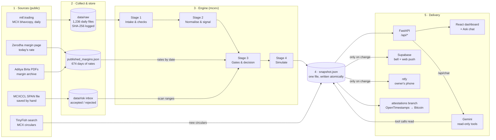
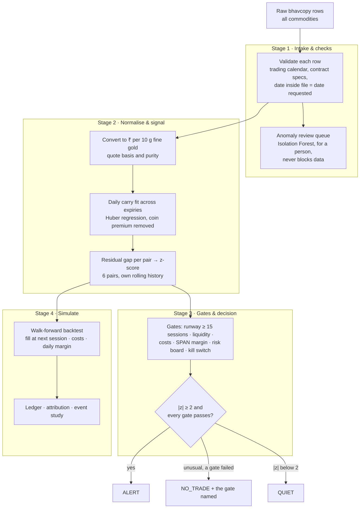
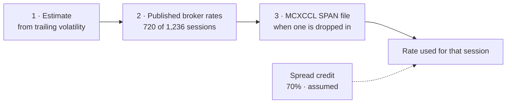
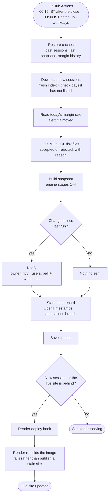
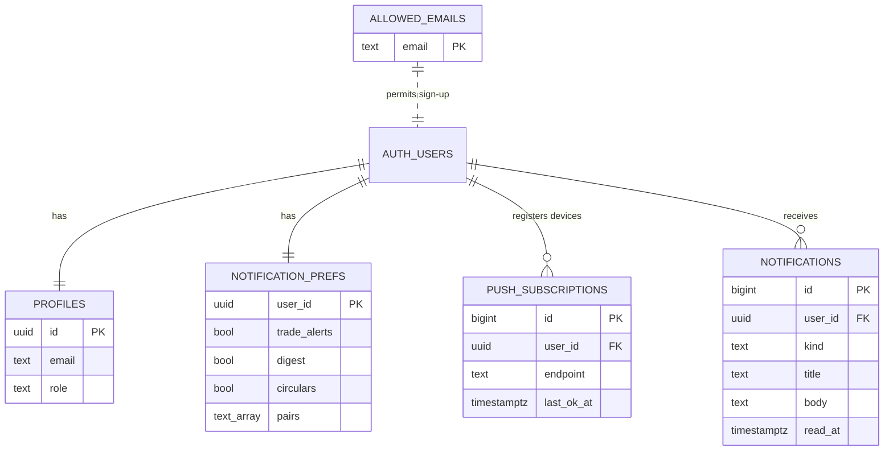
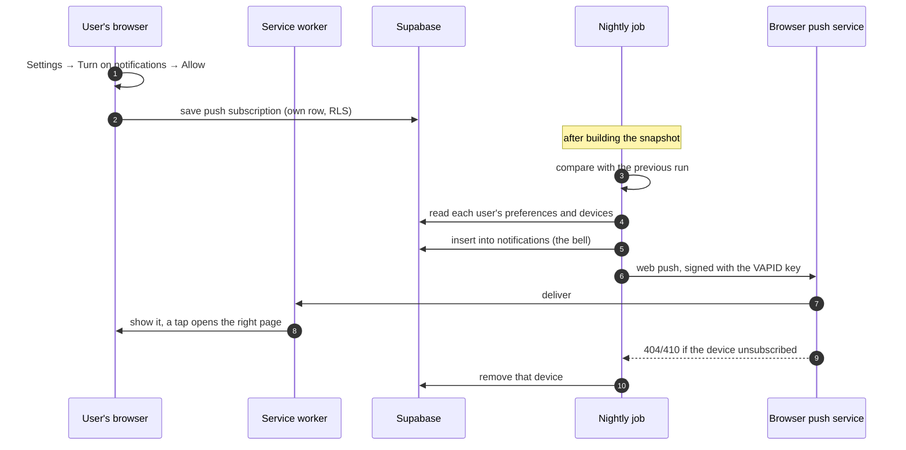
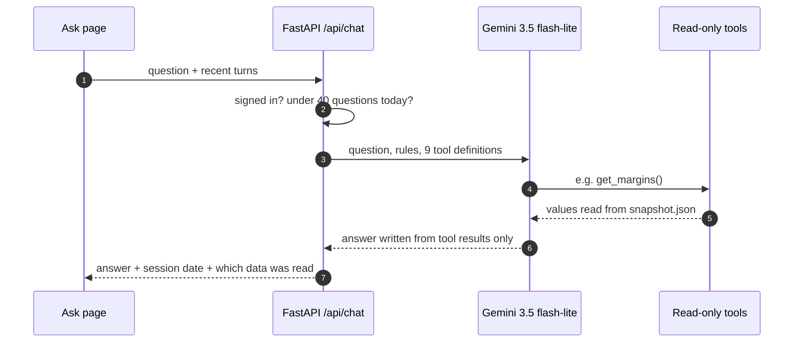
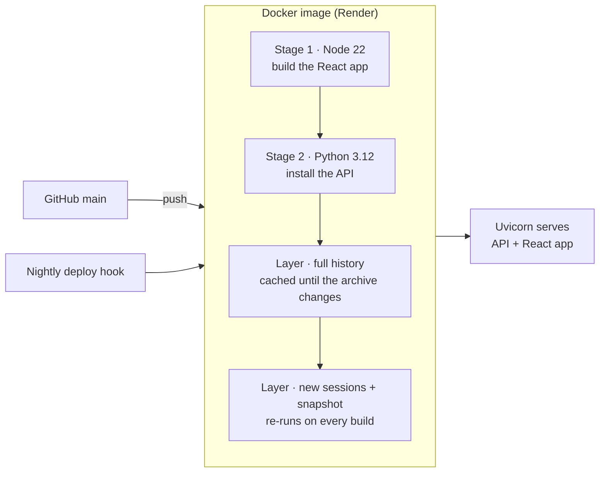

# Architecture: MCX Gold Spread Monitor

A guide for reviewers: what the system is built with, how its parts connect, and what
happens every night. The diagrams render on GitHub. For the reasoning behind each
modelling choice, see [DETAILS.md](DETAILS.md).

**In one paragraph.** MCX lists four gold futures (GOLDM, GOLDTEN, GOLDGUINEA,
GOLDPETAL) that are the same metal in different sizes and purities. Every evening the
system loads the exchange's settlement prices, puts all four on the same footing
(rupees per 10 g of fine gold, normal expiry gap removed), and scores how unusual the
gap is for each of the six pairs. A pair that is unusual and passes every risk gate is
an ALERT. A walk-forward backtest over 1,236 sessions (Jan 2022 – Oct 2026) answers
whether trading those gaps would have paid: **+17.5 bp per trade before costs, −5.3 bp
after**. The gaps are real but smaller than the cost of trading them, and the system
says so. It reads only public data and never places an order.

**Contents**

1. [Tech stack](#1-tech-stack)
2. [System architecture](#2-system-architecture)
3. [The engine, stage by stage](#3-the-engine-stage-by-stage)
4. [Margin: published first, assumed last](#4-margin-published-first-assumed-last)
5. [Nightly workflow](#5-nightly-workflow)
6. [Accounts and data model (Supabase)](#6-accounts-and-data-model-supabase)
7. [Notifications](#7-notifications)
8. [The Ask assistant (Gemini)](#8-the-ask-assistant-gemini)
9. [Tamper-evident record (OpenTimestamps)](#9-tamper-evident-record-opentimestamps)
10. [Deployment](#10-deployment)
11. [Security](#11-security)
12. [Testing](#12-testing)
13. [Repository map](#13-repository-map)

---

## 1. Tech stack

| Layer | Technology | What it does here |
|---|---|---|
| **Engine** | Python 3.12, pandas, NumPy, SciPy | Validation, normalisation, carry fit, z-scores, SPAN margin, backtest |
| | scikit-learn | Huber regression in the daily carry fit; Isolation Forest anomaly review |
| **API** | FastAPI, Uvicorn | Read-only JSON API over the nightly snapshot; sign-in check; chat endpoint |
| **Frontend** | React 18, TypeScript 5, Vite 5 | Single-page dashboard, installable as a phone app (PWA) |
| | React Router, TanStack Query | Page routing; cached data fetching |
| | Recharts | Equity curve, z-score bands, gold level |
| **Accounts & database** | Supabase (Postgres, Auth, Realtime) | Email sign-in, invite-only sign-up, user settings, notification centre |
| **Notifications** | Web Push (VAPID) via `pywebpush`, service worker | Phone and desktop alerts for signed-in users |
| | ntfy | Owner's own phone alerts |
| **Assistant** | Google Gemini via `google-genai` (AI Studio) | "Ask" chat that answers only through read-only tools |
| **Proof** | OpenTimestamps (Bitcoin) | Timestamps each night's record |
| **Data sources** | mtf.trading | MCX bhavcopy (official daily settlement file), republished |
| | Zerodha margin page, Aditya Birla Money PDFs | Published MCX margin rates, today and archive |
| | TinyFish search API | New MCX circulars |
| **Automation** | GitHub Actions | Nightly job (data, snapshot, notify, stamp, redeploy); CI tests |
| **Hosting** | Render (Docker) | Serves the API and the React app; data is built into the image |
| **Optional store** | PostgreSQL via `psycopg` | Canonical database layer for research runs (not needed by the live site) |

---

## 2. System architecture



**How to read it.** Data flows left to right. Everything the user sees, on any page, in
any notification, or in a chatbot answer, is read from **one file**, `snapshot.json`,
which the engine writes once per night. That single source is what keeps the
dashboard, the alerts and the assistant consistent with each other.

- **Sources** are all public. MCX's own site blocks automated downloads, and the
  project does not work around that; the bhavcopy comes from a mirror that was
  spot-checked row for row against the exchange's file.
- **Collect & store** keeps raw files exactly as received, each with a SHA-256
  fingerprint, so a changed file is detectable.
- **The engine** runs four stages (next section).
- **Delivery** never recomputes anything; it reads the snapshot.

---

## 3. The engine, stage by stage



**Stage 1 — Intake & checks.** Every row is checked against the trading calendar and
each contract's specification (quote basis, purity, expiry window). A file whose
internal date differs from the date requested is rejected, which catches a mirror
re-serving an old day. 1,35,464 rows are read; 17,575 gold-futures rows are kept.
An Isolation Forest scores every kept row for how unusual it looks and places the top
ones in a review queue. It flags; it never deletes or blocks.

**Stage 2 — Normalise & signal.** MCX quotes GOLDM per 10 g at 995 purity and GOLDPETAL
per 1 g at 999, so raw prices are not comparable. Everything becomes rupees per 10 g of
fine gold. A daily fit across all expiry months removes the normal cost of carry (later
months cost more) and the slow-moving premium on coin contracts. What remains is the
mispricing; for each pair it is turned into a z-score against that pair's own history.

**Stage 3 — Gates & decision.** Unusual (|z| ≥ 2) is necessary but not sufficient. The
pair must also have enough sessions before expiry, enough liquidity, room after costs,
affordable margin, a risk board that accepts the added exposure, and an account not
halted by the drawdown kill switch. Every decision carries its reason.

**Stage 4 — Simulate.** The backtest walks forward one session at a time, using only
information available that day. It fills every trade at the **next** session's price
(the settlement is only published after the close), charges bid/ask, brokerage and
exchange fees on both legs, and computes the SPAN margin of the whole open book every
day. Exits: gap back to |z| ≤ 0.5, a stop at |z| ≥ 4.5, 40 sessions, or expiry.

---

## 4. Margin: published first, assumed last



Margin is the cash the exchange blocks per position. MCX computes it with **SPAN**
(Standard Portfolio Analysis of Risk): the worst likely move (the *scan range*), plus a
1.25% extreme-loss margin, any additional margin, and a 6% minimum.

The engine implements SPAN and takes each session's rate from the most authoritative
source available **for that date**: an MCXCCL file beats a published broker rate, which
beats the volatility estimate. A rate is only used from the session it could have been
known, and carried at most 14 days, so the backtest never uses a future margin. Gold
margin moved between 7.25% and about 28% (February 2026).

The **spread credit** (the discount for offsetting positions) is not in any public
source the project can reach, so it is an explicit, labelled assumption.

---

## 5. Nightly workflow



**What each run does.** The job runs twice every weekday: at 00:15 IST, after MCX's
evening session has closed, and at 09:00 IST to pick up a session the mirror published
late. It only downloads sessions it does not already have.

**Two decisions keep it quiet and correct.**

- *Changed since last run?* Notifications go out only when a status actually changed,
  so a normal second run sends nothing.
- *New session, or the site behind?* The website is rebuilt only when there is
  something new to show, or when the live site reports an older session than this run
  (it is checked through its public `/api/health`).

**Failure handling.** A timestamp-server outage or an unreadable margin page is skipped
so the night still completes. A failed download or engine error stops the run. A Render
build that cannot get the newest listed session fails on purpose, so the previous
deploy keeps serving, and the next nightly run rebuilds it.

---

## 6. Accounts and data model (Supabase)



- **Sign-in:** Supabase Auth, email and password.
- **Invite-only:** a trigger on `auth.users` refuses any sign-up whose email is not in
  `allowed_emails`. A second trigger creates the new user's profile and default
  notification settings.
- **Row-level security on every table:** the database itself lets each user read and
  change only their own rows. Users may only mark their own notifications as read; the
  content stays as the job wrote it.
- **Two keys:** the browser holds only the public (publishable) key. The nightly job
  uses the secret key, which bypasses row-level security to write notifications; it is
  kept in GitHub and Render secrets and never sent to the browser.
- **The API checks the sign-in on every request** (`/api/*`, except health and config).

Schema: [`supabase/migrations/`](../supabase/migrations/).

---

## 7. Notifications



Each user chooses **trade alerts**, a quiet **evening summary** of unusual points, and
**exchange notices** (new MCX circulars, margin changes), and can follow only some
pairs. The bell in the app updates live through Supabase Realtime. The owner also
receives alerts on ntfy. Nothing is sent on a night when nothing changed.

---

## 8. The Ask assistant (Gemini)



- **Grounded:** Gemini is told to answer only from its tools and to call one for every
  number. The tools (`get_overview`, `get_pairs`, `get_pair`, `get_decisions`,
  `get_backtest`, `get_account`, `get_margins`, `get_circulars`, `get_data_quality`)
  read the same snapshot as the dashboard.
- **Computed, not guessed:** values a language model gets wrong, such as the highest
  margin in a long series, are calculated in code before Gemini sees them.
- **Bounded:** read-only, no trading advice, 40 questions per user per day, 30-second
  timeout; a failure on Google's side does not use up a question.
- Replies in the user's language (English, Hindi or Hinglish).

---

## 9. Tamper-evident record (OpenTimestamps)

Every night the job writes a small JSON record of what the monitor said (each pair's
status, z-score and reason, that session's decisions, the verdict, and the SHA-256 of
the full snapshot). Only the record's **fingerprint** is sent to the public
OpenTimestamps calendars, which commit it into a Bitcoin transaction within hours. The
record and its `.ots` proof are committed to the `attestations` branch.

Anyone can check that a record existed on its date and has not changed since:

```bash
python scripts/attest.py --verify attestations/2026-10-27_feb895be5d61.json
# VERIFIED: ... existed by Bitcoin block 973467 (2026-10-27 23:07 UTC)
```

It proves timing, not that a signal was right.

---

## 10. Deployment

Live at **[mcx-iefc.onrender.com](https://mcx-iefc.onrender.com)** (Render, free plan;
sign-in required, sign-up by invitation). `GET /api/health` is public and returns the
session the site is showing.



The data is downloaded and the snapshot built **at image build time**, not at start-up:
free hosts restart idle containers, and re-downloading 1,200+ sessions on every cold
start would take minutes. The full history sits in a cached layer; the last layer always
re-runs, so a rebuild fetches only what is new (seconds) and rebuilds the snapshot
(about four minutes). Environment variables (Supabase, VAPID, Gemini) are set in
Render, never in the repository.

---

## 11. Security

| Concern | How it is handled |
|---|---|
| Secrets | `.env` is git-ignored; production secrets live in GitHub and Render secret stores |
| Data access | Sign-in required for every data endpoint; row-level security on every table |
| Sign-up | Invite-only, enforced by a database trigger |
| Server key | Used only by the nightly job and the API server, never sent to the browser |
| Assistant | Read-only tools; cannot change data, place orders or give advice; daily limit |
| Source sites | No bot-protection workarounds; only public pages and public APIs |
| Orders | None. The system has no connection to any broker or bank |

---

## 12. Testing

About **315 automated tests** (pytest) run on every push (`.github/workflows/ci.yml`).
They check properties rather than outputs, for example:

- **No look-ahead:** no decision can depend on data from a later session.
- **Falsification:** on synthetic data with no mispricing, the signal finds nothing.
- **Units:** a margin rate is read in the units its column states, never guessed.
- **Margin dating:** a published rate is applied only from when it could have been known.
- **Access:** without sign-in, no data leaves the API; each user hears only what they
  chose.
- **Proofs:** a timestamp proof verifies against its Bitcoin block and fails for a
  changed file.
- **Assistant:** the model gets the rules and tools every call; limits and outages
  behave as specified (Gemini is faked; tests never call Google).

```bash
python -m pytest
```

---

## 13. Repository map

```
mcxrv/                         the engine (Python package)
  stage1_intake/               specs, trading calendar, validation, anomaly review, Postgres layer
  stage2_normalize_signal/     per-gram normalisation, carry fit, z-score, liquidity
  stage3_gates_decision/       costs, SPAN margin, risk board, MCXCCL file parser
  stage4_simulate_deliver/     backtest, position ledger, attribution, event study
  pipeline.py                  the whole run as one call
  snapshot.py                  builds the JSON the API serves
  published_margins.py         broker margin sheets
  notify.py, user_notify.py    ntfy, web push, notification centre
  assistant.py                 Gemini tools and rules
  attest.py                    OpenTimestamps records
api/                           FastAPI app
frontend/                      React + TypeScript dashboard (PWA)
scripts/                       nightly job, downloaders, invites, analysis report
supabase/migrations/           database schema, triggers, row-level security
tests/                         pytest suite
.github/workflows/             nightly job and CI
Dockerfile, render.yaml        image and hosting
docs/                          this file and the full write-up (DETAILS.md)
```
